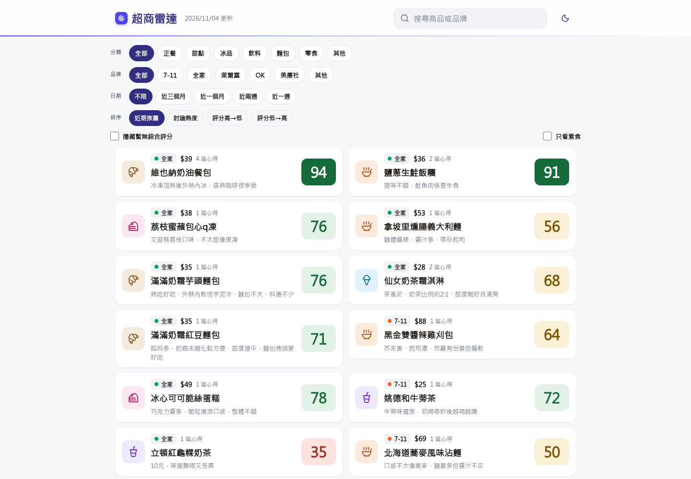
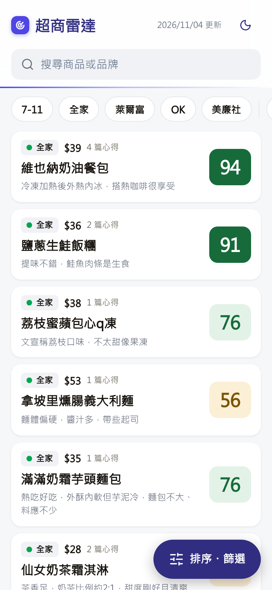
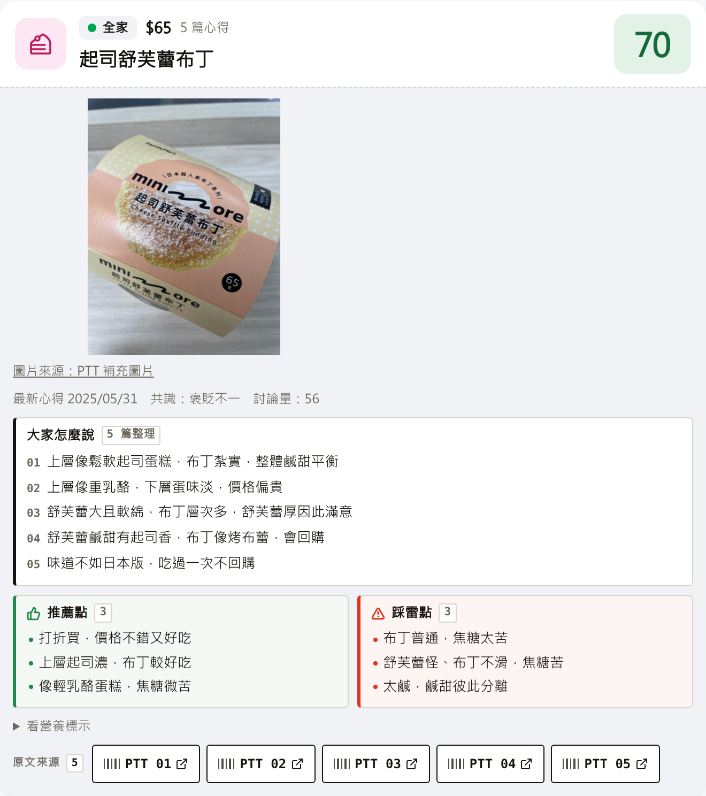
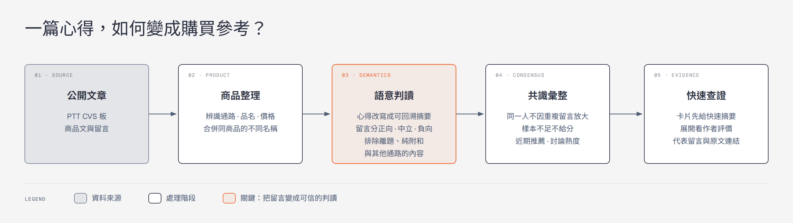
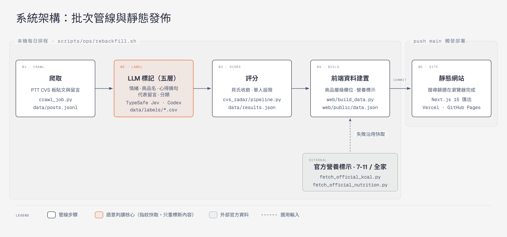

# CVS Radar

> Standing in front of the shelf, decide what to buy in 30 seconds.

[](https://github.com/YuHsunWang/cvs-radar/actions/workflows/ci.yml)
[](https://github.com/YuHsunWang/cvs-radar/actions/workflows/pages.yml)


**[Live demo](https://cvs-radar.vercel.app/)** · **[繁體中文](README.md)**

Whether a new convenience-store product is any good is an answer scattered across review posts and replies on Taiwan's PTT CVS board. CVS Radar turns that into one ranked shelf: one card per product, one score, one line of takeaway, and a tap to see what everyone said and jump back to the original posts.

It covers about 2,400 products from nearly 2,800 review posts going back to June 2024, across 7-Eleven, FamilyMart, Hi-Life and OK Mart. The UI is in Traditional Chinese.

## Product preview

<p align="center">
  
</p>

<p align="center">
  
  &nbsp;&nbsp;
  
</p>

**Finding a product**

- The default sort is "recent recommendation": well-reviewed products that people discussed recently come first. Discussion volume and plain score are the other sorts.
- Filter by category (meals, desserts, frozen treats, drinks, bread, snacks), brand and review date. On phones a quick-filter row sits above the list, so the common filters don't need the sheet.
- "Vegetarian only" lists products whose package or ingredient list was checked by hand; unchecked products are never shown as vegetarian.
- Search treats the two spellings of curry (咖喱 / 咖哩) as one word.
- The URL keeps the search, filters, sort and the open product, so a copied link reopens the same view.

**Reading a product**

- A closed card shows only the chain, price, number of reviews, name, one takeaway and the score.
- Opened, it shows a product photo, one takeaway per review, pros and cons, and a link to every PTT post.
- More than 80% of products have a photo, from the chain's official site or a PTT review, each with its source.
- Products with an official nutrition label can expand it; 7-Eleven and FamilyMart give calories, and some FamilyMart products give the full table.
- Dark mode is supported.

## From a review post to a score

<p align="center">
  
</p>

1. **Collect** product posts and replies from the PTT CVS board.
2. **Identify the product**: chain, name and price, merging differently written names of the same item. A post that reviews several products is split.
3. **Read the meaning**: each reply is positive, neutral or negative; off-topic replies, bare agreement and talk about other chains are dropped. Each author's review is rewritten as one line that traces back to the source.
4. **Aggregate**: one account counts once, however many times it replies; too few people means no score.
5. **Verify**: the card gives the quick answer, and every claim links back to its post.

## How the score works

A reply is not one vote. It is first judged to count or not, then weighted, then pooled with every other opinion on the product. Code: `cvs_radar/scoring/compute.py`; parameters: `config.yaml`.

**Weight of each opinion**

```
weight = credibility(account) × role_weight(role) × exp(−λ · days)
```

- Authors and repliers both have role weight `1.0`.
- Time decay is off (`λ = 0`): an old review is not discounted for being old. Freshness only drives the "recent recommendation" sort (24-day half-life), not the score.
- Account credibility is `max(0.1, 1 − suspicion)`. Suspicion uses only the three signals that describe astroturfing: same-brand bursts within 24 hours (0.45), near-duplicate replies (0.40) and always-extreme ratings (0.15). Accounts with fewer than 5 replies are not scored.
- Suspicion only **down-weights internally; no account is ever labelled publicly**. Published data has no account fields; `cvs_radar/store.py` strips and validates them at write time.

**One person, one vote**: all of an account's opinions on a product are averaged into a single stance before pooling. Otherwise one person booing five times counts as five people.

**Paid-review accusations**: when replies call a post paid promotion, the accused post's author is down-weighted. It takes at least two different accounts to count.

**No score without enough people**

```
fair01 = (prior_strength · μ₀ + Σ wᵢsᵢ) / (prior_strength + Σ wᵢ)     # μ₀ = 0.5, prior_strength = 1.0
n_eff  = (Σ wᵢ)² / Σ wᵢ²
```

`n_eff` is the effective sample size: the more the weight sits on a few people, the smaller it gets. Below `n_eff < 3` a product is "not enough data" and shows neither a score nor a positive/neutral/negative split — about a quarter of products stay blank. Fewer than 4 qualifying repliers also hides the score. A blank beats a precise-looking number that three people produced.

**Consensus labels** come from the weighted mean `μ` and standard deviation `σ`: `σ ≥ 0.26` is polarised; `μ ≥ 0.68` with `σ ≤ 0.25` is consistently positive; `μ ≤ 0.45` with `σ ≤ 0.25` is consistently negative; the rest is mixed.

Details: [scoring decisions](docs/DECISIONS.md) and [labelling guideline](docs/labeling_guideline.md).

## LLM in the loop, still reproducible

Five semantic layers — sentiment, product name, review takeaway, representative reply and category — are read by an LLM. Every result is cached in `data/labels/*.csv`, keyed by a content fingerprint, and committed.

The fingerprint holds everything the model saw. For sentiment:

```
SHA-256( post ID | push tag | NFKC-normalised reply | brand | product name | post title | prompt version )
```

So the same input never calls the model again and always yields the same score, and changing a prompt invalidates the old answers by itself. That keeps CI runnable and cost bounded. A change is verified by running the full pipeline before and after and diffing the whole result set, not by green unit tests alone.

## Architecture

<p align="center">
  
</p>

All reading and scoring happens in a batch pipeline before publishing and produces one `web/public/data.json`. The site is static: search and filtering run in the browser, with no backend.

| Layer | Stack |
|---|---|
| Collection | Python, Requests, Beautiful Soup |
| Semantic labels | Five LLM layers, cached by content fingerprint in `data/labels/*.csv` |
| Scoring | Rule-based sentiment, Bayesian shrinkage, one vote per account, account down-weighting |
| Frontend | Next.js 15, React 19, TypeScript, Tailwind CSS |
| Quality | Pytest, Vitest, Ruff, TypeScript, Next.js production build |
| Hosting | Vercel (primary), GitHub Pages (static mirror) |

## Run it locally

Needs Python 3.12+ and Node.js 20. Start from the repo root.

**Website**

```bash
python -m pip install ".[core]"
cd web
npm ci
npm run build:data
npm run dev
```

Open `http://localhost:3000`.

**Pipeline (offline demo)**

```bash
python -m pip install -r requirements.txt
python run.py --demo
```

`--demo` uses synthetic posts and needs no network. Real crawling must respect the source site's rate limits and terms. `cvs_radar/api.py` also offers a local FastAPI query service; the public site does not use it.

## Verification

Same checks as CI:

```bash
python -m pip install ".[core,api,dev]"
python -m pytest -q
ruff check .

cd web
npm ci
npm run build:data
git diff --exit-code -- public/data.json
npm test
npx tsc --noEmit
npm run build
```

Over four hundred backend tests and over a hundred frontend tests cover parsing edge cases, product merging, sentiment attribution, one vote per account, score calibration, search and filters, shareable links and the static export.

## Deployment and data updates

The site lives at <https://cvs-radar.vercel.app/>. Every push to `main` redeploys on Vercel with `web/` as the root; <https://yuhsunwang.github.io/cvs-radar/> is a static mirror built by `.github/workflows/pages.yml`. Both read the same `web/public/data.json`.

Data is refreshed by a scheduling host outside this repo running `scripts/ops/rebackfill-cron.sh`: crawl, label, rescore, build the public data, and commit it back to `main`. The repository neither contains nor proves that host's crontab; if the schedule stops, the repo does not update itself, and `scripts/check_data_freshness.py` checks for stale data. `.github/workflows/refresh-data.yml` is a manual fallback only and runs none of the five labelling layers. Full flow: [Ops pipeline](docs/ops-pipeline.md).

## Layout

```text
cvs_radar/              parsing, sentiment, scoring, service and reports
config.yaml             scoring, sentiment and crawler parameters
crawl_job.py            PTT crawl, storage and recompute entry point
run.py                  offline demo and pipeline CLI
scripts/                labelling, audits, official nutrition data
  ops/                  local publishing pipeline and cron wrapper
tests/                  backend and data-build tests
web/
  components/           product cards, filters and detail
  lib/                  search, filter, sort and shareable-link logic
  build_data.py         turns results and label caches into public data
  public/data.json      product data the browser reads
data/labels/            LLM labels, manual overrides, vegetarian marks, photo manifest
docs/                   scoring decisions, pipeline, trap log and screenshots
```

## Limits

- Semantic reading can still misread sarcasm, memes and comparisons with a dropped subject, so manual overrides and source links stay.
- Product merging relies on normalised names; rare name variants can still split or merge wrongly.
- The site is a precomputed snapshot, not live data.
- Photos for new products are added by hand, so a new item may have none at first.
- Vegetarian marks cover only the few products checked by hand; no mark does not mean not vegetarian.

## Disclaimer

This is an independent portfolio project with no affiliation to PTT or any convenience-store chain. Reviews come from public user content and are a buying aid, not an objective quality claim. How photos are used and removed: [product images](docs/product-images.md).
