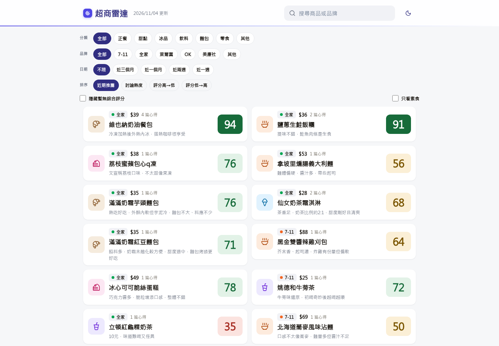
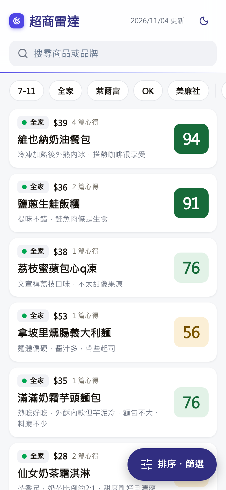
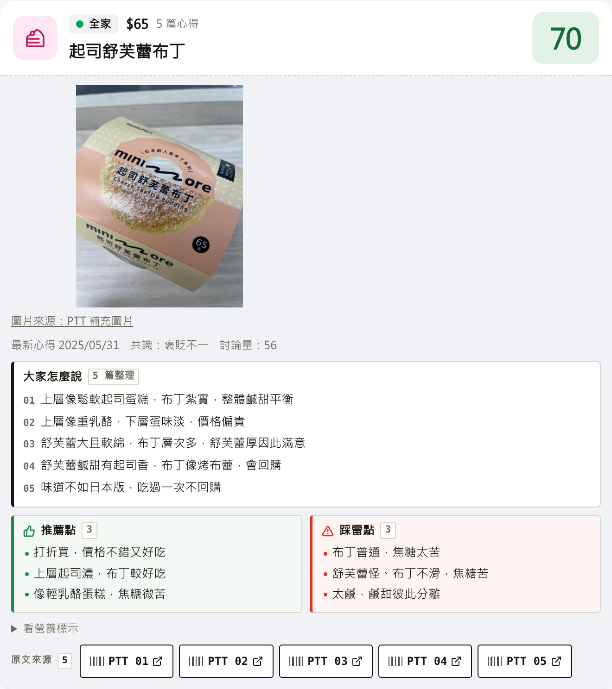
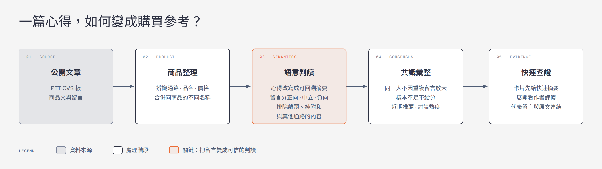
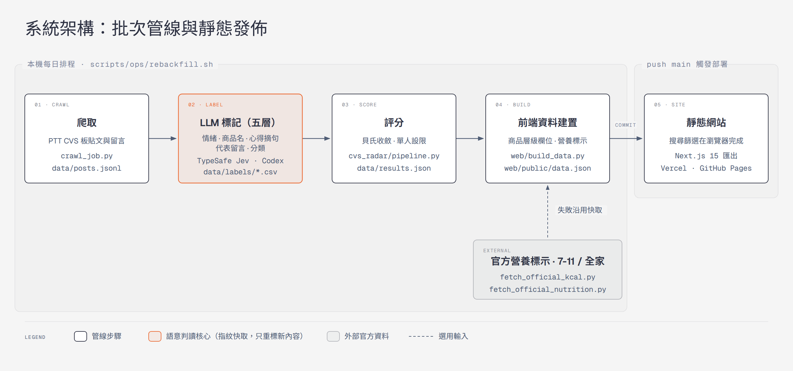

# CVS Radar 超商雷達

> 站在超商貨架前，30 秒決定買哪一個。

[](https://github.com/YuHsunWang/cvs-radar/actions/workflows/ci.yml)
[](https://github.com/YuHsunWang/cvs-radar/actions/workflows/pages.yml)


**[線上試用](https://cvs-radar.vercel.app/)** · **[English](README.en.md)**

超商新品好不好吃，答案散在 PTT CVS 板的心得文和推文裡。CVS Radar 把這些討論整理成一張排行榜：每個商品一張卡，一個分數，一句重點，點開就能看大家怎麼說，再回到原文查證。

目前收錄約 2,400 項商品，整理自近 2,800 篇心得文，資料從 2024 年 6 月開始累積。7-11、全家、萊爾富、OK 都有。

## 產品樣貌

<p align="center">
  
</p>

<p align="center">
  
  &nbsp;&nbsp;
  
</p>

**找商品**

- 預設排序是「近期推薦」：評價好、而且最近有人討論的商品排前面。也可以切換「討論熱度」或依分數排序。
- 依分類（正餐、甜點、冰品、飲料、麵包、零食）、品牌、心得日期篩選。手機上方有一排快捷按鈕，不用打開篩選面板。
- 「只看素食」只列出包裝或成分表確認過的素食商品；沒確認過的商品不會被當成素食。
- 搜尋把「咖喱」和「咖哩」當成同一個詞，兩種寫法都找得到。
- 網址會記住目前的搜尋、篩選、排序和點開的商品，複製網址就能分享同一個畫面。

**看一個商品**

- 卡片收起時只顯示通路、價格、心得篇數、品名、一句重點和分數。
- 點開後看得到商品照片、每一篇心得的一句整理、推薦點與踩雷點，以及每篇 PTT 原文的連結。
- 八成以上的商品有照片，來源是超商官網或 PTT 心得文，每張都標出處。
- 有官網營養標示的商品可以展開營養表；7-11 與全家提供熱量，部分全家商品另有完整營養素。
- 支援暗色模式。

## 一篇心得怎麼變成分數

<p align="center">
  
</p>

1. **收集**：讀取 PTT CVS 板的商品文與留言。
2. **認商品**：辨識通路、品名與價格，把寫法不同但其實是同一個的商品合併。一篇文章講好幾個商品時，會拆開來算。
3. **讀意思**：每則留言判成正面、中立或負面，排除離題、純附和、在講別家的內容。作者心得改寫成一句可以對回原文的整理。
4. **算共識**：同一個人留言再多也只算一票；人數不夠就不給分。
5. **能查證**：卡片給快速結論，點開後每個說法都能連回原文。

## 評分怎麼算

一則留言不是一票。它先被判斷算不算數，再給一個權重，最後和同商品的其他意見一起收斂成分數。程式在 `cvs_radar/scoring/compute.py`，參數在 `config.yaml`。

**每則意見的權重**

```
weight = credibility(帳號) × role_weight(角色) × exp(−λ · 天數)
```

- 作者和留言者的角色權重都是 `1.0`。
- 時間衰減 `λ = 0`：舊心得不會因為舊就被打折。新鮮度只用在「近期推薦」排序（24 天半衰期），不影響分數本身。
- 帳號可信度 `credibility = max(0.1, 1 − suspicion)`。可疑分只看三個跟灌票有關的訊號：24 小時內對同品牌連發（0.45）、留言彼此高度雷同（0.40）、打分老是極端（0.15）。留言少於 5 則的帳號不評。
- 可疑分**只用來在內部降權，不對外標記任何帳號**。公開資料不含帳號欄位，寫入時由 `cvs_radar/store.py` 清除並驗證。

**一人一票**：同一帳號在同一商品下的所有發言，先加權平均成一個立場，再進商品層。否則一個人連噓五則就等於五個人。

**業配指控**：留言指控某篇是業配時，降權的是被指控那篇的作者。至少要兩個不同帳號指控才算數。

**樣本不夠就不給分**

```
fair01 = (prior_strength · μ₀ + Σ wᵢsᵢ) / (prior_strength + Σ wᵢ)     # μ₀ = 0.5, prior_strength = 1.0
n_eff  = (Σ wᵢ)² / Σ wᵢ²
```

`n_eff` 是有效樣本數：權重越集中在少數人身上，它就越小。`n_eff < 3` 就判為「資料不足」，前端不顯示綜合評分也不顯示正／中／負百分比——約四分之一的商品因此留白。另外，合格留言者少於 4 位時也不顯示分數。寧可留白，也不給一個只有三個人講過、看起來卻很精確的數字。

**共識標籤**：用加權平均 `μ` 和標準差 `σ` 分成四種——`σ ≥ 0.26` 是評價兩極；`μ ≥ 0.68` 且 `σ ≤ 0.25` 是一致好評；`μ ≤ 0.45` 且 `σ ≤ 0.25` 是一致負評；其他是褒貶不一。

細節見 [評分決策](docs/DECISIONS.md) 與 [標註規範](docs/labeling_guideline.md)。

## 用了 LLM，結果還是能重現

情緒、品名、心得整理、代表留言、分類這五層都由 LLM 判讀。每筆結果用「內容指紋」當 key，快取在 `data/labels/*.csv` 並進版控。

指紋包含模型當時看到的每一樣東西，以情緒層為例：

```
SHA-256( 文章 ID ｜ 推噓標籤 ｜ NFKC 正規化留言 ｜ 品牌 ｜ 商品名 ｜ 文章標題 ｜ prompt 版本 )
```

所以相同的輸入不會再呼叫模型，也一定算出相同的分數；改了 prompt，舊答案會自動失效。這也讓 CI 跑得動、成本可控。驗證一個改動時，做法是改動前後各跑一次完整管線、比對整份結果，而不是只看單元測試綠燈。

## 系統架構

<p align="center">
  
</p>

所有判讀和計算都在發佈前的批次管線做完，產出一份 `web/public/data.json`。網站是靜態頁面，搜尋和篩選都在瀏覽器裡完成，沒有後端。

| 層 | 技術 |
|---|---|
| 資料收集 | Python、Requests、Beautiful Soup |
| 語意標記 | LLM 五層判讀，以內容指紋快取於 `data/labels/*.csv` |
| 評分 | 規則式情緒、貝氏收斂、一人一票、帳號降權 |
| 前端 | Next.js 15、React 19、TypeScript、Tailwind CSS |
| 品質 | Pytest、Vitest、Ruff、TypeScript、Next.js production build |
| 部署 | Vercel（主要）、GitHub Pages（靜態鏡像） |

## 在本地執行

需要 Python 3.12 以上和 Node.js 20。以下步驟都從 repo 根目錄開始。

**網站**

```bash
python -m pip install ".[core]"
cd web
npm ci
npm run build:data
npm run dev
```

開啟 `http://localhost:3000`。

**資料管線（離線範例）**

```bash
python -m pip install -r requirements.txt
python run.py --demo
```

`--demo` 使用合成的範例貼文，不需要網路。實際爬取請遵守來源站台的速率限制與使用條款。`cvs_radar/api.py` 另有一個本地用的 FastAPI 查詢服務，公開網站不需要它。

## 驗證

與 CI 的檢查一致：

```bash
python -m pip install ".[core,api,dev]"
python -m pytest -q
ruff check .

cd web
npm ci
npm run build:data
git diff --exit-code -- public/data.json
npm test
npx tsc --noEmit
npm run build
```

後端四百多個測試、前端一百多個測試，涵蓋解析邊界、商品合併、情緒歸屬、一人一票、分數校準、搜尋與篩選、分享網址與靜態匯出。

## 部署與資料更新

網站在 <https://cvs-radar.vercel.app/>。每次 push 到 `main`，Vercel 會以 `web/` 為根目錄重新部署；<https://yuhsunwang.github.io/cvs-radar/> 是由 `.github/workflows/pages.yml` 建置的靜態鏡像。兩邊讀同一份 `web/public/data.json`。

資料由 repo 外部的排程主機執行 `scripts/ops/rebackfill-cron.sh`：爬取、標記、重算、建置公開資料，再 commit 回 `main`。repository 本身不包含或證明該主機的 crontab；排程如果停了，repo 不會自己更新，`scripts/check_data_freshness.py` 會檢查資料有沒有過期。`.github/workflows/refresh-data.yml` 只是手動備案，不跑五個標記層。完整流程見 [Ops 管線](docs/ops-pipeline.md)。

## 專案結構

```text
cvs_radar/              解析、情緒、評分、服務與報表
config.yaml             評分、情緒與爬蟲參數
crawl_job.py            PTT 爬取、儲存與重算入口
run.py                  離線範例與管線 CLI
scripts/                標記、稽核、官方營養資料等工具
  ops/                  本地發佈管線與 cron wrapper
tests/                  後端與資料建置測試
web/
  components/           商品卡、篩選與詳情
  lib/                  搜尋、篩選、排序與分享網址邏輯
  build_data.py         把結果與標記快取轉成公開資料
  public/data.json      瀏覽器讀取的商品資料
data/labels/            LLM 標記、人工覆寫、素食標示、商品照片清單
docs/                   評分決策、管線、陷阱紀錄與截圖
```

## 限制

- 語意判讀還是可能誤讀反諷、迷因和省略主詞的比較句，所以保留人工覆寫和原文連結。
- 商品合併靠正規化後的名稱，罕見的命名變體仍可能拆開或誤合。
- 網站是預先算好的快照，不是即時資料。
- 新商品的照片要手動補上，所以新品一開始可能沒有照片。
- 素食標示只涵蓋人工確認過的少數商品；沒有標示不代表不是素食。

## 聲明

這是獨立的作品集專案，與 PTT 及任何超商品牌都沒有關聯。商品評價來自公開的使用者內容，應視為購買參考，而不是客觀的品質主張。照片的使用與移除方式見 [商品照片](docs/product-images.md)。
